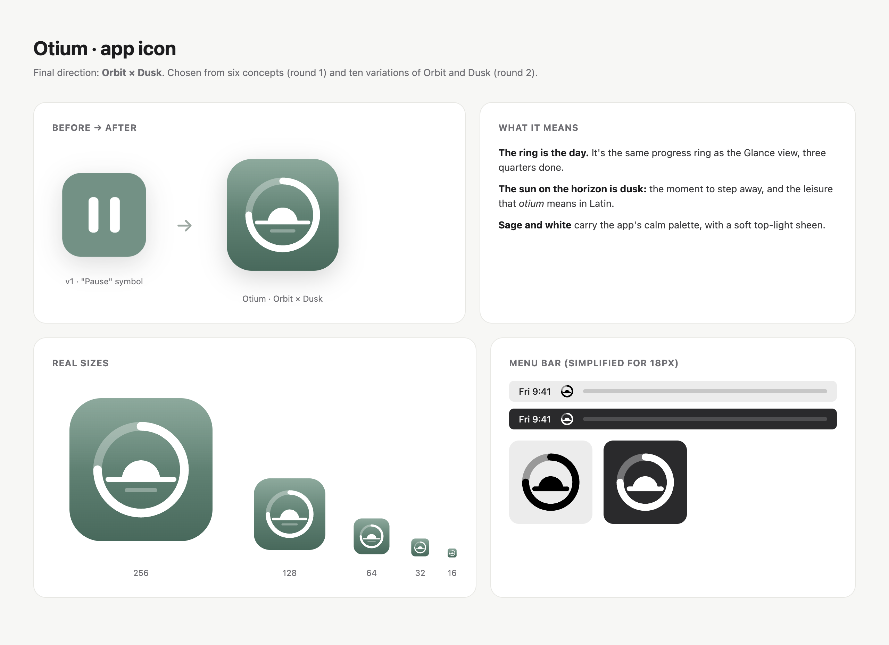
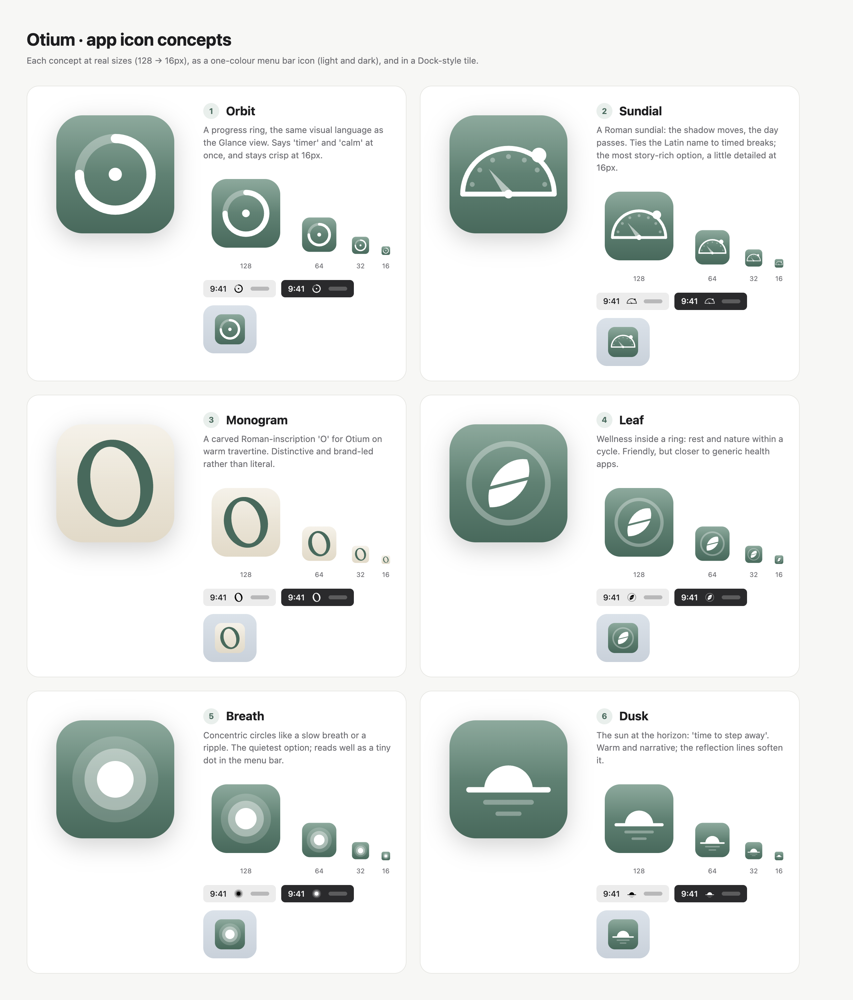
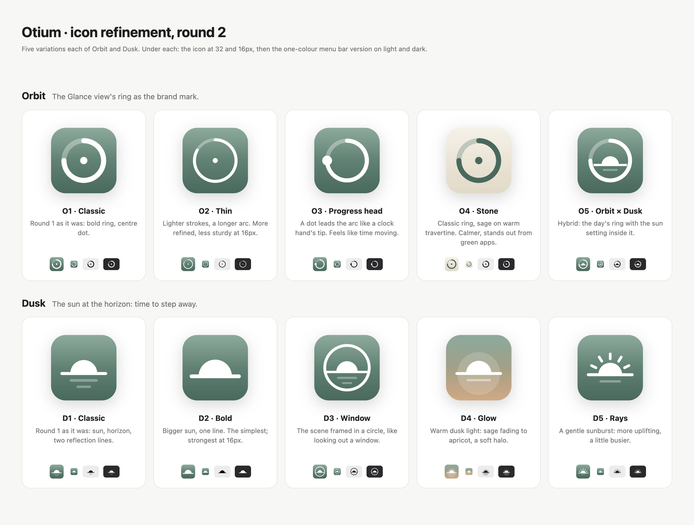

# Otium: app icon exploration

**Project:** Otium, a calm macOS menu bar app for healthy work breaks
**Date:** 21 November 2026
**Outcome:** the placeholder "pause" icon was replaced by **Orbit × Dusk**, chosen from 6 concepts and 10 variations over three rounds.

---

## 1. Where we started

The first icon was made alongside v1, when the app was still called **Pause**. It's a sage rounded square with two white bars: the universal "pause" symbol.

It did its job as a placeholder, but by the time of this exploration it had three problems:

- **It belonged to the old name.** Once the app was renamed **Otium**, the pause bars no longer connected to anything.
- **It reads as a media control.** Two bars are what you press to pause a song or a video. In a menu bar full of other apps, that's confusing.
- **It doesn't say what the app is about.** Otium is about rest and time passing. The icon showed neither.

## 2. What a good icon needed to do

Before drawing, we agreed on five criteria to judge every option against:

| Criterion | Why it matters |
|---|---|
| **Meaning** | Connect to the name (*otium*, Latin for leisure, time away from work) or to what the app does (timed breaks). |
| **Legible at 16px** | macOS shows app icons as small as 16px in lists and menus. |
| **Works as a one-colour menu bar icon** | Otium lives in the menu bar. macOS draws menu bar icons in a single colour (black on light, white on dark), so the idea must survive with no colour at all. |
| **Calm, and consistent with the app** | Use the app's sage palette and quiet tone, not a loud logo. |
| **Distinctive** | Avoid looking like every other green health app. |

Every concept was drawn on the standard macOS icon grid (an 824px rounded square inside a 1024px canvas) and checked at 128, 64, 32 and 16px, in a light and a dark menu bar, and in a Dock-style tile.

## 3. Round 1: six directions

| # | Concept | Starting point | Assessment |
|---|---|---|---|
| 1 | **Orbit** | The progress ring from the app's Glance view | Strongest overall: ties the icon to the product and stays crisp at 16px. |
| 2 | **Sundial** | Roman timekeeping, linking the Latin name to time | Best story, but it **read as a speedometer**. A redraw (tapered shadow, softer hour dots, a sun) didn't fix it: a half dial with a pointer just says "gauge". |
| 3 | **Monogram** | A Roman-inscription "O" for Otium on warm travertine | Most brand-like and distinctive. Risk: in the menu bar it could read as a zero. An inner dot was removed because it made the O look like a Greek theta (Θ). |
| 4 | **Leaf** | Rest and nature inside a ring | Friendly but generic. Its centre vein first disappeared (same colour as the leaf), so it was redrawn as a cut-out. |
| 5 | **Breath** | Concentric circles, like a slow breath | The calmest, but too abstract: nothing says "timer". |
| 6 | **Dusk** | The sun at the horizon: "time to step away" | Warm and narrative, and reads well small. |

**Decision:** take **Orbit** and **Dusk** forward. Orbit was the strongest product mark; Dusk carried the emotional idea of stepping away.

## 4. Round 2: refining Orbit and Dusk

Five variations of each, each changing one thing (weight, detail, framing or colour), so the sheet shows which decisions matter.

**Orbit**

| Variation | Change | Verdict |
|---|---|---|
| O1 · Classic | Round 1 version | Safe and legible. |
| O2 · Thin | Lighter strokes, longer arc | More elegant large, weaker at 16px. |
| O3 · Progress head | A dot at the end of the arc | **Ruled out:** reads as a "refresh/reload" arrow in the menu bar. |
| O4 · Stone | Sage ring on warm travertine | Calm and distinctive; the strongest "pure" Orbit. |
| O5 · Orbit × Dusk | The sun setting inside the ring | **The most meaningful:** time passing *and* stepping away, in one mark. |

**Dusk**

| Variation | Change | Verdict |
|---|---|---|
| D1 · Classic | Round 1 version | Reflection lines blur when small. |
| D2 · Bold | Bigger sun, single horizon | Strongest at 16px, but plain. |
| D3 · Window | The scene framed in a circle | Calm and lovely. |
| D4 · Glow | Sage-to-apricot "dusk light" background | Warmest and most unusual; the gradient goes slightly muddy mid-way. |
| D5 · Rays | A sunburst | **Ruled out:** looks like a weather app. |

**Key insight:** the two directions **converged**. O5 (from Orbit) and D3 (from Dusk) both ended up as *the sun inside a circle*. When two separate lines of thinking land on the same form, that's a strong signal it's the right idea.

**Decision:** **O5 · Orbit × Dusk**.

## 5. Round 3: finalising

### What it means
- **The ring is the day.** It's the same progress ring as the Glance view, three quarters done.
- **The sun on the horizon is dusk:** the moment to step away, and the leisure that *otium* means.
- **Sage and white** carry the app's calm palette.

### Refinements made while finalising
1. **The horizon line floats inside the ring.** At first it ran to the ring's inner edge and was cut off at an angle, which showed at large sizes. It was shortened and given rounded ends.
2. **A simplified menu bar version.** At 18px the reflection line turned to mush, so the menu bar icon keeps only the ring, the sun and the horizon, with a thicker ring. It's drawn in black on transparent so macOS can tint it for light and dark menu bars.

### Specification

| | App icon | Menu bar icon |
|---|---|---|
| Canvas | 1024 × 1024, 824px rounded square, 185px corner radius | Cropped to the ring (580 × 580 units), shown at 18px and 36px |
| Background | Vertical gradient `#6E9A89` → `#3E6A5B`, plus a soft white sheen on the top half | None (transparent) |
| Ring | Radius 250, stroke 50, white. Faint full track at 32% opacity, plus a 270° arc from 12 o'clock, clockwise, round ends | Stroke 70, black; track at 35% opacity |
| Sun | Half circle, radius 110, on the horizon at y = 568 | Radius 125 |
| Horizon | x 322 → 702, stroke 28, round ends | x 352 → 672, stroke 48 |
| Reflection | x 430 → 594 at y = 630, stroke 24, 32% opacity | Left out (too small to read) |

### Where it lives in the project
- **Sources:** `design/app-icon/otium-app.svg` and `design/app-icon/otium-menubar.svg`
- **Exports:** `build/icon.png` (1024px, from which the macOS `.icns` is made) and `resources/trayTemplate.png` / `trayTemplate@2x.png` (18px and 36px menu bar icons)
- **Regenerate after edits:** `npm run icons`
- **Exploration sources:** `design/icon-concepts/` (round 1) and `design/icon-concepts/round-2/`

## 6. What we learned

- **Test at the real size early.** Two options that looked good large (Progress head, Rays) failed at 16px or in the menu bar because they read as other, familiar symbols.
- **Watch for borrowed meanings.** A gauge, a refresh arrow, a weather sun and a theta all came from shapes that already mean something else to people.
- **Convergence is a signal.** The final idea appeared from two directions at once.
- **One mark, two versions.** A detailed app icon and a simplified menu bar glyph can share one idea without being identical.

## 7. Possible next steps

- **A "living" menu bar icon:** the ring in the menu bar could fill as the next break approaches, so the icon itself shows progress.
- **Newer macOS icon styles:** a layered version of the icon for macOS's dark and tinted icon appearances.
- **Small-size hinting:** a hand-tuned 16px and 32px version, if the icon ever looks soft in Finder lists.
